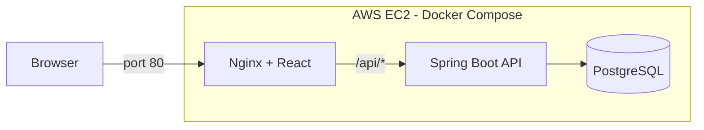
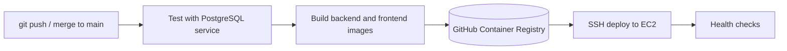
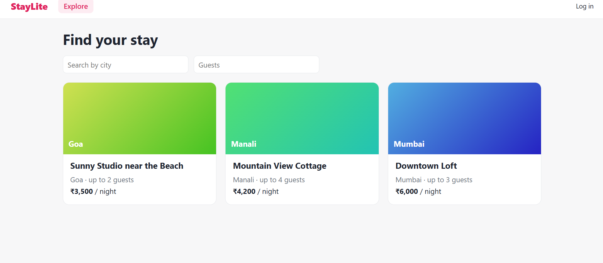
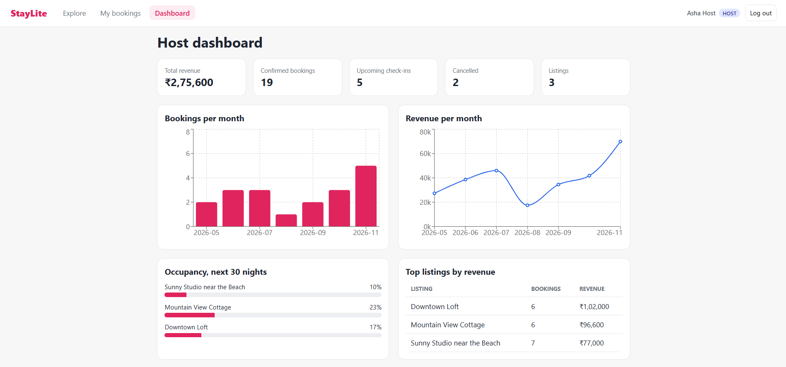

# StayLite


A booking platform inspired by home-rental marketplaces. Guests search listings and book stays; hosts get a dashboard with revenue, bookings, and occupancy. Double-bookings are prevented by the database itself, and everything ships through an automated CI/CD pipeline to AWS.

**Live demo:** http://13.63.235.124

| Role | Email | Password |
|---|---|---|
| Host | asha@staylite.com | demo1234 |
| Guest | ravi@staylite.com | demo1234 |

Demo data only. Anyone can also sign up as a guest.

## Features

- Browse and filter listings, live availability check, price calculation
- Bookings that cannot overlap (PostgreSQL exclusion constraint) with cancellation
- **Host dashboard:** revenue, bookings per month, occupancy for the next 30 nights, top listings
- **JWT authentication** with BCrypt passwords, host-only endpoints, and per-user ownership checks

## Architecture



Only port 80 is public. The API and database are reachable only inside the Docker network.

## CI/CD pipeline



1. **Test:** Maven build and tests on Java 25 against a throwaway Postgres.
2. **Build:** two Docker images, tagged with the commit SHA and `latest`, pushed to GHCR.
3. **Deploy:** SSH to EC2, write the release `.env`, `docker compose pull && up -d`.
4. **Verify:** health checks on the API, the data endpoint, and the React app. A failed check fails the pipeline.

Pull requests run the tests and build the images but never deploy. Dependabot opens weekly update PRs, each tested by the same pipeline.

## Checkpoints

| Tag | Milestone |
|---|---|
| v0.1 | Backend and Postgres running locally |
| v0.2 | CI: build and test on every push |
| v0.3 | Docker image built and pushed to GHCR |
| v0.4 | Automatic deploy to EC2, live link |
| v0.5 | Dashboard API and React frontend |
| v0.6 | Frontend container, full site deployed |
| v1.0 | JWT authentication, final polish |

**Rollback:** every release is tagged with its commit SHA. To roll back, set `TAG=<older-sha>` in `~/staylite/.env` on the server and run `docker compose -f docker-compose.prod.yml up -d`. Data is kept.

## Run locally

```bash
docker compose up -d --build
```

- Site: http://localhost:8081
- API: http://localhost:8080/api/listings

For development with hot reload: `docker compose up -d db backend`, then `cd frontend && npm install && npm run dev` (http://localhost:5173).

## Tech stack

Java 25, Spring Boot 4, Spring Security (JWT), Flyway, PostgreSQL 16, React (Vite) with Recharts, Nginx, Docker, GitHub Actions, GitHub Container Registry, AWS EC2.

## Security notes

- Passwords hashed with BCrypt; tokens are signed JWTs that expire after 2 hours
- Identity always comes from the token, never from request parameters
- Secrets (SSH key, DB password, JWT secret) live in GitHub Secrets and the server's `.env`, never in git
- The database has no public port

## Screenshots


