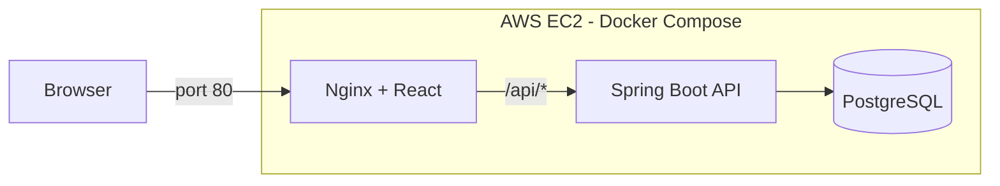
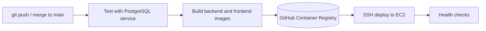
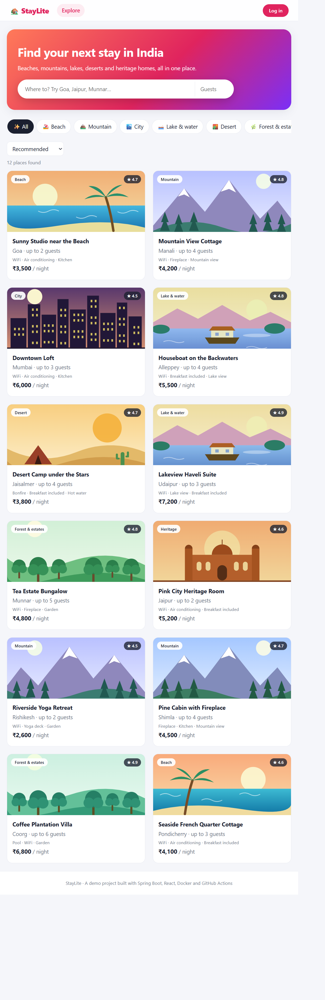
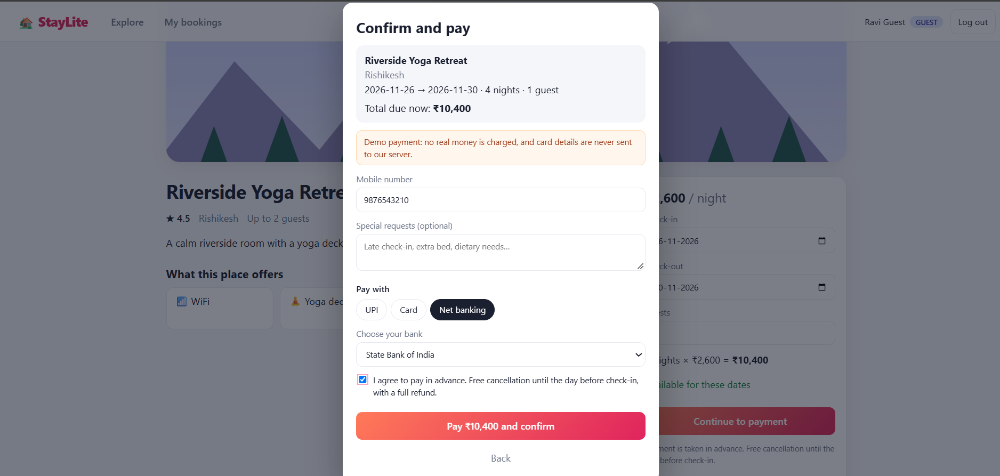
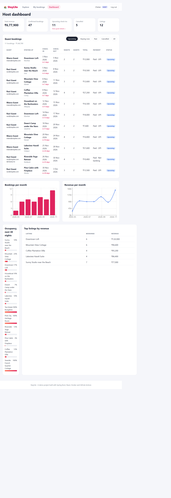
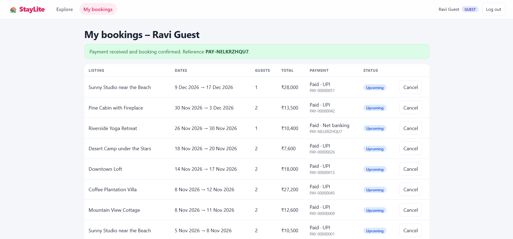

# StayLite


A booking platform inspired by home-rental marketplaces. Guests search stays across India, pay in advance and book. Hosts get a dashboard with revenue, occupancy, and full guest details. Double-bookings are prevented by the database itself, and every change ships through an automated CI/CD pipeline to AWS.

**Live demo:** http://13.63.235.124 (plain HTTP, no HTTPS)

| Role | Email | Password |
|---|---|---|
| Host | chetan@staylite.com | demo1234 |
| Guest | ravi@staylite.com | demo1234 |

Demo data only. Anyone can also sign up as a guest.

**Test card for the demo checkout:** `4242 4242 4242 4242`, any future expiry (for example `12/30`), any CVV. No real money is charged.

## Features

**Guests**
- Browse 12 stays across India with category filters, sorting, and search by city and guests
- Live availability check and price total on every listing
- **Advance payment checkout:** mobile number, special requests, and a choice of UPI, card or net banking, plus acceptance of the booking terms
- My bookings with payment reference, status, and cancellation
- Free cancellation until the day before check-in, with a full refund

**Booking statuses** are worked out from the dates, so they never go stale:

| Status | When |
|---|---|
| Upcoming | Check-in is today or later |
| Staying now | Check-in has passed, check-out has not |
| Completed | Check-out has passed |
| Cancelled | The guest cancelled |

The Cancel button appears only on bookings that can still be cancelled, and the server enforces the same rule.

**Hosts**
- Dashboard with revenue, bookings per month, occupancy for the next 30 nights, and top listings
- **Guest bookings table:** guest name, email and phone, the place and city, check-in and check-out dates, nights, total, payment, and status, with tabs for Upcoming, Staying now, Past, Cancelled and All
- A host sees only the bookings for their own listings

**Platform**
- JWT login with BCrypt-hashed passwords and role-based access
- Bookings that cannot overlap (PostgreSQL exclusion constraint)
- Original SVG illustrations for each stay category, with no image files

## Architecture



Only port 80 is public. The API and database are reachable only inside the Docker network.

## CI/CD pipeline



1. **Test:** Maven build and tests on Java 25 against a throwaway Postgres.
2. **Build:** two Docker images, tagged with the commit SHA and `latest`, pushed to GHCR.
3. **Deploy:** SSH to EC2, write the release `.env`, then `docker compose pull && up -d`.
4. **Verify:** health checks on the API, the data endpoint, and the React app. A failed check fails the pipeline and prints the server logs.

Pull requests run the tests and build the images but never deploy. Dependabot opens weekly update PRs, and each one is tested by the same pipeline.

## API overview

| Endpoint | Who | Purpose |
|---|---|---|
| `POST /api/auth/login`, `POST /api/auth/register` | Public | Get a token, create a guest account |
| `GET /api/auth/me` | Logged in | Current user |
| `GET /api/listings`, `GET /api/listings/{id}` | Public | Browse, filter (`city`, `guests`, `category`), sort (`sort`) |
| `GET /api/bookings/availability` | Public | Check dates |
| `POST /api/bookings` | Guest | Book and pay (phone, payment method, terms required) |
| `GET /api/bookings` | Guest | Own bookings, with status and `canCancel` |
| `POST /api/bookings/{id}/cancel` | Owner | Cancel a future booking, which marks the payment refunded |
| `GET /api/dashboard/summary`, `monthly`, `top-listings`, `occupancy` | Host | Dashboard numbers |
| `GET /api/dashboard/bookings?when=` | Host | Guest details (`upcoming`, `current`, `past`, `cancelled`, `all`) |

## Database migrations (Flyway)

| Version | Change |
|---|---|
| V1 | Listings table |
| V2 | Seed listings |
| V3 | Users and bookings, plus the no-overlap constraint |
| V4 | Seed users |
| V5 | Demo bookings |
| V6 | Password hashes for users |
| V7 | Listing category, rating and amenities, plus nine more places |
| V8 | Demo host renamed to Chetan |
| V9 | Booking payment and guest contact details |

## Checkpoints

| Tag | Milestone |
|---|---|
| v0.1 | Backend and Postgres running locally |
| v0.2 | CI: build and test on every push |
| v0.3 | Docker image built and pushed to GHCR |
| v0.4 | Automatic deploy to EC2, live link |
| v0.5 | Dashboard API and React frontend |
| v0.6 | Frontend container, full site deployed |
| v1.0 | JWT authentication, final polish |

Later releases added the UI refresh, host guest details, completed-booking rules, and the advance payment checkout.

**Rollback:** every release is tagged with its commit SHA. To roll back, set `TAG=<older-sha>` in `~/staylite/.env` on the server and run `docker compose -f docker-compose.prod.yml up -d`. Data is kept.

## Run locally

```bash
docker compose up -d --build
```

- Site: http://localhost:8081
- API: http://localhost:8080/api/listings

For development with hot reload: `docker compose up -d db backend`, then `cd frontend && npm install && npm run dev` (http://localhost:5173).

Run the backend tests with the database running: `cd backend && ./mvnw test`.

## Tech stack

Java 25, Spring Boot 4, Spring Security (JWT), Flyway, PostgreSQL 16, React (Vite) with Recharts, Nginx, Docker, GitHub Actions, GitHub Container Registry, AWS EC2.

## Security notes

- Passwords are hashed with BCrypt. Tokens are signed JWTs that expire after 2 hours.
- Identity always comes from the token, never from request parameters.
- The dashboard is host-only (403 for guests), and a host sees only their own listings.
- **The payment is a simulation.** Card, UPI and bank details are validated in the browser and never sent to the server. The server stores only the payment method, a reference, and the status. A production system would use a hosted payment provider and never handle card numbers itself.
- Secrets (SSH key, DB password, JWT secret) live in GitHub Secrets and the server's `.env`, never in git.
- The database has no public port.

## Known limitations

- No HTTPS (it needs a domain name), no login rate limiting, and no password reset
- Tokens are kept in `localStorage`. An httpOnly cookie would be safer in production.
- Booking dates use the server's UTC clock, so statuses can be a few hours off around midnight in India
- A single EC2 server, so there is no high availability
- Hosts cannot yet add or edit listings from the UI

## Screenshot





